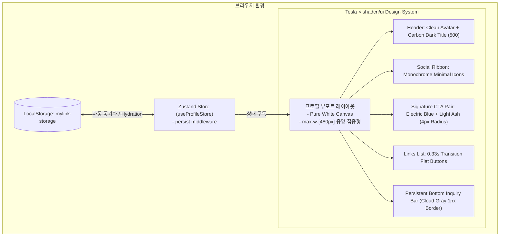

# [PRD] 링크트리 클론 서비스: 마이링크 (MyLink)

> **버전**: v1.4 (shadcn/ui × Tesla Design System 통합 규격)  
> **상태**: 1단계 개발 범위 및 디자인 시스템 확정  
> **디자인 시스템**: **shadcn/ui** 기반 + **Tesla Design System (`design.md`)** 스타일 가이드라인 결합  
> **기술 스택**: Next.js (v16+), React (v19+), TypeScript (v7+), **Tailwind CSS (v4+ CSS-first)**, **shadcn/ui**, **Zustand (persist 미들웨어)**  
> **스토리지**: 브라우저 LocalStorage (Mock Data 기반)  

---

## 1. 개요 및 로드맵 (Overview & Roadmap)

본 프로젝트는 점진적 시연(Step-by-step Demo)을 위해 단계를 나누어 개발을 진행합니다.  
현재 **1단계(Phase 1)**에서는 관리자 대시보드나 복잡한 통계 기능은 배제하고, **`design.md`에 명시된 테슬라(Tesla)의 극단적 절제미(Radical Subtraction)와 shadcn/ui의 접근성 높은 컴포넌트 아키텍처를 결합한 완성도 높은 '프로필 페이지(Profile Page)'**를 구현하는 데 집중합니다.

### 📌 단계별 마일스톤
- **[현재 단계] Phase 1: 테슬라 감성의 프로필 페이지 (Profile Page)**
  - shadcn/ui 기반 컴포넌트 테슬라 토큰화 (버튼 4px Radius, Zero Shadow, 0.33s 트랜지션)
  - Zustand + LocalStorage 자동 영속화 연동
  - 프로필 헤더(아바타, 이름, 바이오), 소셜 아이콘 바, 시그니처 CTA 2-버튼 페어 및 링크 목록 렌더링
  - 하단 영구 고정 인터랙션 바 (Tesla "Ask a Question" Bar 컨셉의 Persistent Bottom Bar)
  - 초기 Mock Data 자동 주입 및 로컬 영속화
- **[예정] Phase 2: 실시간 편집기 & 관리자 대시보드**
  - 테슬라 인터페이스 특유의 미니멀 폼 컨트롤(shadcn Form, Input, Dialog, DropdownMenu)
  - 링크 추가/수정/삭제/순서변경(DnD)
  - 테마 및 프로필 커스텀 설정
- **[예정] Phase 3: 분석 및 통계 (Analytics)**
  - 절제된 모노크롬 메트릭 카드 및 shadcn/ui 차트 컴포넌트 기반
  - 페이지 조회수(PV) 및 링크별 클릭수 트래킹

---

## 2. 디자인 시스템 및 UI 표준: shadcn/ui × Tesla Design System

본 서비스의 모든 UI/UX는 **[shadcn/ui](https://ui.shadcn.com/)** 컴포넌트를 기본 골격으로 하되, 비주얼과 인터랙션은 **Tesla Design System (`design.md`)**의 철학을 엄격하게 준수합니다.

### 2.1 디자인 핵심 철학: Radical Subtraction (극단적 덜어내기)
1. **장식적 요소 완전 배제**: 그림자(Drop Shadows), 그라데이션(Gradients), 화려한 테두리(Borders), 도트/격자 패턴 및 장식용 스티커를 일체 사용하지 않습니다.
2. **여백(Whitespace)을 통한 럭셔리 전달**: 넉넉하고 정돈된 여백 자체가 컨텐츠를 돋보이게 하는 프레임 역할을 수행합니다.
3. **단 하나의 유채색 원칙 (Electric Blue `#3E6AE1`)**: 시각적 주의가 분산되지 않도록 주요 행동 유도(Primary CTA) 버튼과 활성 상태 링크에만 단 하나의 액센트 컬러를 사용합니다.

### 2.2 컬러 팔레트 & 시맨틱 역할 (Color Architecture)

| 역할 | 명칭 | HEX / RGBA | 용도 및 규칙 |
| :--- | :--- | :--- | :--- |
| **Primary CTA** | Electric Blue | `#3E6AE1` | 주 행동 버튼 배경, 링크 복사 성공/프로모션 텍스트. 유일한 유채색 |
| **Canvas / Background** | Pure White | `#FFFFFF` | 메인 페이지 배경, 카드 컨테이너, 세컨더리 버튼 배경 |
| **Surface (Subtle)** | Light Ash | `#F4F4F4` | 세컨더리 버튼/대체 표면 (Pure White와 미세한 명도 차이) |
| **Heading / Nav Text** | Carbon Dark | `#171A20` | 크리에이터 닉네임, 메인 타이틀, 최상위 텍스트 (웜 니어블랙) |
| **Body / Content Text** | Graphite | `#393C41` | 본문 바이오 소개글, 기본 설명 텍스트 |
| **Sub-link / Tertiary** | Pewter | `#5C5E62` | 3차 링크(프로필 공유/복사), 부가 설명 텍스트 |
| **Muted / Placeholder** | Silver Fog | `#8E8E8E` | 입력창 플레이스홀더, 비활성 텍스트 |
| **Divider / Light Border** | Cloud Gray | `#EEEEEE` | 하단 바 등 필수 영역 구분을 위한 1px 극세선 |
| **Frosted Glass** | Frosted Glass | `rgba(255, 255, 255, 0.75)` | 스크롤 시 상단 헤더의 `backdrop-blur` 반투명 배경 |

### 2.3 타이포그래피 규칙 (Typography Rules)
- **폰트 패밀리**: `Universal Sans` 풍의 기하학적이면서도 정돈된 산세리프 (시스템 기본: `-apple-system, BlinkMacSystemFont, "Segoe UI", Roboto, sans-serif` 또는 `Geist Sans`)
- **가중치(Weight) 극단적 절제**:
  - `500` (Medium): 모델명/닉네임, 네비게이션, CTA 버튼 라벨
  - `400` (Regular): 본문 바이오, 서브링크, 설명문
  - *Bold(700)나 Light(300) 등 극단적인 굵기는 사용하지 않음*
- **자간 (Letter Spacing)**: 인위적인 음수 자간(negative tracking) 없이 모든 레벨에서 `normal` 유지
- **대소문자 태도**: 소문자 중심의 차분하고 절제된 톤앤매너 유지 (과도한 대문자 변환 지양)

### 2.4 컴포넌트 스타일링 규격 및 아키텍처 (shadcn/ui × Tailwind CSS)

1. **스타일링 아키텍처: 100% Tailwind CSS 통일 및 CSS Modules 전면 배제**:
   - **CSS Modules(`.module.css`) 사용 금지**: 스타일 파편화를 방지하고 디자인 토큰의 단일 출처(Single Source of Truth)를 유지하기 위해 CSS Modules 및 임의의 인라인 `style` 속성 사용을 전면 배제합니다.
   - 모든 레이아웃, 컬러, 타이포그래피, 트랜지션은 **Tailwind CSS (CSS-first / utility-first)** 클래스로 일관되게 작성합니다.
   - 테슬라 트랜지션 타이밍은 전역 유틸리티 클래스(`.transition-tesla`)로 통일하여 사용합니다.

2. **shadcn/ui 기반 컴포넌트 아키텍처 및 재사용성 (Component Reusability)**:
   - 본 페이지의 모든 핵심 UI 요소는 **[shadcn/ui](https://ui.shadcn.com/)** 프리미티브 컴포넌트를 기반으로 제작하여 프로젝트 전반에서 독립적으로 재사용할 수 있도록 설계합니다.
   - **Button (`@/components/ui/button`)**: CVA(Class Variance Authority)를 통해 테슬라 규격(`primary`, `secondary`, `sublink`) variant를 내장하여 재사용.
   - **Avatar (`@/components/ui/avatar`)**: 프로필 아바타 및 이니셜 폴백 처리를 담당하는 재사용 컴포넌트.
   - **Badge (`@/components/ui/badge`)**: 링크 카드의 상태 및 태그(`Featured`, `Open Source` 등)를 표시하는 독립 컴포넌트.
   - **Card (`@/components/ui/card`)**: 링크 리스트 및 프로필 정보 컨테이너의 표준 골격.

3. **Button 상세 규격 (shadcn/ui `<Button />`)**:
   - **모서리 반경**: `rounded-[4px]` (barely-rounded rectangle) — 둥근 필(Pill) 형태가 아닌 정밀하게 가공된 엔지니어링 미학 적용
   - **크기**: 최소 높이 `40px` (카드형 버튼은 `min-h-[52px]`), 모바일/데스크톱 모두 명확한 터치 타겟 보장
   - **Primary Variant**: 배경 `bg-[#3E6AE1]`, 글자 `text-white`, 호버 시 미세한 명도 저하(`hover:bg-[#345ac2]`)
   - **Secondary Variant**: 배경 `bg-[#F4F4F4]`, 글자 `text-[#393C41]`, 호버 시 `hover:bg-[#EAEAEA]`
   - **Sublink Variant**: 배경 없음, 글자 `text-[#5C5E62]`, 호버 시 `text-[#171A20]` 밑줄 전환
4. **트랜지션 (Universal Transition)**:
   - 모든 인터랙티브 상태 변화는 **`0.33s cubic-bezier(0.5, 0, 0, 0.75)`**의 테슬라 고유 타이밍 적용 (`transition-tesla`)
   - 크기 확대(scale)나 위치 이동(translate) 같은 물리적 왜곡 애니메이션을 금지하고, 부드러운 색상/투명도 전환만 적용
5. **Elevation & Depth (그림자 완전 배제)**:
   - **Level 0 (Flat)**: 그림자 없음 (`shadow-none`), 테두리 없음. 기본 상태
   - **Level 1 (Frost)**: 반투명 글래스(`rgba(255, 255, 255, 0.75)`) + 블러(`backdrop-blur-md`)를 통한 레이어 분리
6. **Persistent Bottom Bar (Tesla "Ask a Question" Bar 컨셉)**:
   - 화면 하단에 sticky로 고정되는 화이트 바 (`border-t border-[#EEEEEE]`)
   - 좌측: 문의 유도 문구 및 아이콘 / 우측: 이메일 링크 및 브랜드 표기

### 2.5 Do's & Don'ts 요약

| 구분 | Do (권장) | Don't (금지) |
| :--- | :--- | :--- |
| **스타일링** | **100% Tailwind CSS 통일**, shadcn/ui 컴포넌트 재사용 | **CSS Modules(`.module.css`)**, 임의의 인라인 `style={{ ... }}` |
| **컴포넌트** | shadcn/ui 기반 커스텀 프리미티브(`button`, `avatar`, `badge`) 활용 | 디자인 시스템과 무관한 외부 서드파티 위젯 무분별한 도입 |
| **컬러** | 모노크롬 베이스 + Primary CTA에만 Electric Blue (`#3E6AE1`) 사용 | 버튼마다 알록달록한 다채로운 색상 사용 |
| **장식** | 순수한 화이트 여백과 정갈한 텍스트로 컨텐츠 강조 | 드롭 섀도우, 네온 글로우, 비비드 스티커, 격자 도트 배경 |
| **버튼** | 4px 모서리 반경, 40px 이상 높이, 0.33s 색상 전환 | 둥근 알약형(Pill, `rounded-full`), 클릭 시 튕기는 bounce 효과 |
| **애니메이션** | 0.33s cubic-bezier 기반의 우아하고 절제된 색상 페이드 | scale-105 스케일업, translate 이동 등 과장된 모션 |
| **레이아웃** | 중앙 정렬된 클린 뷰포트 레이아웃 (최대 480px) | 윈도우 창 탑바, 장식용 닫기/최소화 버튼 등 레트로 OS 요소 |

---

## 3. Phase 1 핵심 아키텍처



---

## 4. 사용자 시나리오 (User Scenarios)

### 시나리오 1: 방문자의 미니멀 링크 탐색 및 단절 없는 이동
- **상황**: 방문자가 인스타그램 또는 프로필 공유 링크를 통해 모바일 브라우저로 마이링크 페이지에 접속한다.
- **행동**:
  1. 페이지 진입 즉시 잡음 없는 순백의 캔버스 위에 크리에이터의 아바타, Carbon Dark(`500`) 타이틀, Graphite(`400`) 소개글을 확인한다.
  2. 하단 소셜 리본에서 미니멀한 모노크롬 소셜 아이콘을 확인하고 원하는 채널로 즉시 이동한다.
  3. 중앙의 시그니처 2-버튼 페어(Electric Blue '주요 링크/이메일' + Light Ash '보조 링크/GitHub') 및 하단 링크 목록을 훑어본다.
  4. 4px 반경의 정밀한 버튼을 탭하면 0.33s의 매끄러운 색상 피드백과 함께 외부 페이지가 즉시 열린다.
  5. 3차 서브링크("프로필 링크 복사하기")를 누르면 Pewter 텍스트가 Electric Blue 피드백 텍스트로 부드럽게 전환된다.
  6. 화면 하단에 고정된 미니멀 인콰이어리 바를 통해 크리에이터에게 즉시 이메일 문의를 남길 수 있다.
- **기대 결과**: 복잡한 비주얼 노이즈 없이 오직 컨텐츠와 행동에만 집중되는 고급스러운 테슬라 쇼룸 감성의 탐색 경험을 제공한다.

### 시나리오 2: 시연자(발표자)의 초기 로드 및 로컬 영속화 검증
- **상황**: 발표자가 로컬 브라우저에서 최초 접속하여 테슬라 디자인 시스템과 데이터 영속성을 시연한다.
- **행동**:
  1. LocalStorage가 비어있는 상태에서 페이지가 로드되면, Zustand 스토어가 사전 정의된 테슬라 테마 Mock Data를 로컬에 자동 기록한다.
  2. 일체의 렌더링 깜빡임(Hydration mismatch) 없이 완전한 테슬라 스타일의 화면이 렌더링된다.
  3. 개발자 도구의 LocalStorage(`mylink-storage`)에 데이터가 보존됨을 확인하고, 새로고침 시에도 동일한 상태가 즉시 복원된다.

---

## 5. Phase 1 기능 요구사항 (Functional Requirements)

### 5.1 프로필 헤더 (Clean Hero Header)
- **아바타 (shadcn Avatar)**: 깔끔한 원형 프레임, 테두리 및 그림자 없음. 이미지 미설정 시 Carbon Dark 폴백 이니셜 표시
- **사용자 이름/닉네임**: `Carbon Dark (#171A20)`, `17px~20px`, `Font Weight 500`, 자간 `normal`
- **소개글 (Bio)**: `Graphite (#393C41)`, `14px`, `Font Weight 400`, `Line Height 1.43`

### 5.2 소셜 아이콘 바 (Monochrome Ribbon)
- **배치**: 소개글 하단 중앙 정렬
- **디자인**: 컬러풀한 브랜드 고유색 대신 테슬라 모노크롬 톤(`Pewter #5C5E62` → 호버 시 `Carbon Dark #171A20`)으로 렌더링
- **트랜지션**: `transition: color 0.33s cubic-bezier(0.5, 0, 0, 0.75)`

### 5.3 시그니처 CTA 버튼 페어 & 링크 목록 (Signature Pair & Links)
- **컴포넌트**: shadcn/ui `<Button />` 커스텀
- **사양**:
  - `borderRadius: 4px` (정밀한 테슬라 엣지)
  - `minHeight: 40px`
  - 그림자 완전 제거 (`shadow-none`)
- **Primary CTA**:
  - 배경: `Electric Blue (#3E6AE1)`
  - 텍스트: `Pure White (#FFFFFF)`, `14px`, `Font Weight 500`
  - 호버: `#345ac2`로 0.33s 페이드
- **Secondary CTA**:
  - 배경: `Light Ash (#F4F4F4)`
  - 텍스트: `Graphite (#393C41)`, `14px`, `Font Weight 500`
  - 호버: `#EAEAEA`로 0.33s 페이드
- **Tertiary Sub-link**:
  - 텍스트: `Pewter (#5C5E62)`, `14px`, `Font Weight 400`
  - 인터랙션: 클릭 시 Electric Blue 텍스트로 전환되며 클립보드 복사 안내

### 5.4 뷰포트 하단 고정 바 (Persistent Bottom Bar)
- **위치**: 뷰포트 하단 sticky 고정 (`sticky bottom-0 z-40`)
- **스타일**: Pure White 배경 + 상단 1px Cloud Gray 구분선 (`border-t border-[#EEEEEE]`)
- **구성**:
  - 좌측: 문의 안내 문구 및 아이콘 (`Silver Fog #8E8E8E`)
  - 우측: 크리에이터 문의 이메일(`Electric Blue #3E6AE1`) 및 테슬라 디자인 시스템 브랜딩 표기

---

## 6. Zustand 스토어 및 데이터 모델 명세

### 6.1 TypeScript 인터페이스

```typescript
export interface LinkItem {
  id: string;
  title: string;
  url: string;
  isActive: boolean;
  order: number;
  variant?: "primary" | "secondary" | "sublink"; // 테슬라 버튼 계층
  description?: string;                          // 부가 설명
  badge?: string;                                // 배지 (Featured, Open Source 등)
  category?: "main" | "project" | "blog" | "contact"; // 카테고리 분류
}

export interface SocialLink {
  platform: 'instagram' | 'youtube' | 'tiktok' | 'twitter' | 'github' | 'email';
  url: string;
}

export interface TeslaThemeConfig {
  accentColor: string;       // #3E6AE1 (Electric Blue)
  surfaceColor: string;      // #FFFFFF (Pure White)
  secondarySurface: string;  // #F4F4F4 (Light Ash)
  headingColor: string;      // #171A20 (Carbon Dark)
  bodyColor: string;         // #393C41 (Graphite)
  subtextColor: string;      // #5C5E62 (Pewter)
  borderColor: string;       // #EEEEEE (Cloud Gray)
  borderRadius: string;      // 4px (Barely-rounded)
  transitionTiming: string;  // 0.33s cubic-bezier(0.5, 0, 0, 0.75)
}

export interface ProfileData {
  username: string;
  displayName: string;
  bio: string;
  avatarUrl: string;
  theme: TeslaThemeConfig;
  socials: SocialLink[];
  links: LinkItem[];
}
```

### 6.2 초기 Mock 데이터 (테슬라 테마 기본값 및 실무형 더미 데이터)

```typescript
export const initialProfileData: ProfileData = {
  username: "tesla_creator",
  displayName: "정희원 (Huiwon Jung)",
  bio: "기술과 인터페이스의 극단적 절제를 지향하는 프론트엔드 엔지니어입니다.",
  avatarUrl: "https://images.unsplash.com/photo-1534528741775-53994a69daeb?w=300",
  theme: {
    accentColor: "#3E6AE1",
    surfaceColor: "#FFFFFF",
    secondarySurface: "#F4F4F4",
    headingColor: "#171A20",
    bodyColor: "#393C41",
    subtextColor: "#5C5E62",
    borderColor: "#EEEEEE",
    borderRadius: "4px",
    transitionTiming: "all 0.33s cubic-bezier(0.5, 0, 0, 0.75)",
  },
  socials: [
    { platform: "github", url: "https://github.com/huiwon77" },
    { platform: "email", url: "mailto:a0507072@gmail.com" },
  ],
  links: [
    // 1. 핵심 액션 (Signature Primary CTA)
    {
      id: "link-1",
      title: "1:1 커피챗 & 프로젝트 협업 문의",
      description: "개발 외주, 기술 멘토링, 커피챗 일정을 간편하게 예약하세요.",
      url: "https://mail.google.com/mail/?view=cm&fs=1&to=a0507072@gmail.com",
      isActive: true,
      order: 1,
      variant: "primary",
      badge: "Featured",
      category: "contact",
    },

    // 2. 대표 프로젝트 (Secondary CTA)
    {
      id: "link-2",
      title: "MyLink: 테슬라 감성 링크트리 클론 서비스",
      description: "Next.js 16, React 19, Tailwind v4 기반 미니멀 프로필 링크 서비스",
      url: "https://github.com/huiwon77/my-link-kw",
      isActive: true,
      order: 2,
      variant: "secondary",
      badge: "Open Source",
      category: "project",
    },
    {
      id: "link-3",
      title: "온라인 이러닝 플랫폼 (E-Learning LMS)",
      description: "강의 스트리밍 및 학습 진도율 관리 대시보드 웹 애플리케이션",
      url: "https://demo.example.com/elearning",
      isActive: true,
      order: 3,
      variant: "secondary",
      category: "project",
    },

    // 3. 기술 블로그 & 아티클 (Secondary)
    {
      id: "link-4",
      title: "개발 블로그: 테슬라 디자인 시스템 분석기",
      description: "극단적 절제미(Radical Subtraction)를 웹 UI에 녹여내는 방법",
      url: "https://velog.io/@example/tesla-design-system",
      isActive: true,
      order: 4,
      variant: "secondary",
      category: "blog",
    },
    {
      id: "link-5",
      title: "노션(Notion) 이력서 & 포트폴리오 상세",
      description: "학력, 기술 스택, 프로젝트 상세 회고 및 이력 정리",
      url: "https://notion.so/example/resume",
      isActive: true,
      order: 5,
      variant: "secondary",
      category: "main",
    },

    // 4. 네트워킹 & 서브링크 (Sublink)
    {
      id: "link-6",
      title: "LinkedIn 프로필 바로가기",
      url: "https://linkedin.com/in/example",
      isActive: true,
      order: 6,
      variant: "sublink",
      category: "contact",
    },
    {
      id: "link-7",
      title: "프로필 링크 복사하기",
      url: "#copy",
      isActive: true,
      order: 7,
      variant: "sublink",
      category: "main",
    },

    // 5. 비활성화 예시 (isActive: false)
    {
      id: "link-8",
      title: "2026 회고록 (준비 중)",
      description: "한 해 동안의 성장과 도전 회고",
      url: "https://blog.example.com/2026-review",
      isActive: false,
      order: 8,
      variant: "secondary",
      badge: "Soon",
      category: "blog",
    },
  ],
};
```

### 6.3 백엔드 Mock API 및 JSON 규격 (Mock API Envelope)

```json
{
  "status": "success",
  "statusCode": 200,
  "message": "링크 목록 조회가 완료되었습니다.",
  "data": {
    "profile": {
      "username": "tesla_creator",
      "displayName": "정희원 (Huiwon Jung)",
      "bio": "기술과 인터페이스의 극단적 절제를 지향하는 프론트엔드 엔지니어입니다.",
      "avatarUrl": "https://images.unsplash.com/photo-1534528741775-53994a69daeb?w=300"
    },
    "links": [
      {
        "id": "link-1",
        "title": "1:1 커피챗 & 프로젝트 협업 문의",
        "description": "개발 외주, 기술 멘토링, 커피챗 일정을 간편하게 예약하세요.",
        "url": "https://mail.google.com/mail/?view=cm&fs=1&to=a0507072@gmail.com",
        "isActive": true,
        "order": 1,
        "variant": "primary",
        "badge": "Featured",
        "category": "contact"
      },
      {
        "id": "link-2",
        "title": "MyLink: 테슬라 감성 링크트리 클론 서비스",
        "description": "Next.js 16, React 19, Tailwind v4 기반 미니멀 프로필 링크 서비스",
        "url": "https://github.com/huiwon77/my-link-kw",
        "isActive": true,
        "order": 2,
        "variant": "secondary",
        "badge": "Open Source",
        "category": "project"
      },
      {
        "id": "link-3",
        "title": "온라인 이러닝 플랫폼 (E-Learning LMS)",
        "description": "강의 스트리밍 및 학습 진도율 관리 대시보드 웹 애플리케이션",
        "url": "https://demo.example.com/elearning",
        "isActive": true,
        "order": 3,
        "variant": "secondary",
        "category": "project"
      },
      {
        "id": "link-4",
        "title": "개발 블로그: 테슬라 디자인 시스템 분석기",
        "description": "극단적 절제미(Radical Subtraction)를 웹 UI에 녹여내는 방법",
        "url": "https://velog.io/@example/tesla-design-system",
        "isActive": true,
        "order": 4,
        "variant": "secondary",
        "category": "blog"
      },
      {
        "id": "link-5",
        "title": "노션(Notion) 이력서 & 포트폴리오 상세",
        "description": "학력, 기술 스택, 프로젝트 상세 회고 및 이력 정리",
        "url": "https://notion.so/example/resume",
        "isActive": true,
        "order": 5,
        "variant": "secondary",
        "category": "main"
      },
      {
        "id": "link-6",
        "title": "LinkedIn 프로필 바로가기",
        "url": "https://linkedin.com/in/example",
        "isActive": true,
        "order": 6,
        "variant": "sublink",
        "category": "contact"
      },
      {
        "id": "link-7",
        "title": "프로필 링크 복사하기",
        "url": "#copy",
        "isActive": true,
        "order": 7,
        "variant": "sublink",
        "category": "main"
      }
    ]
  },
  "meta": {
    "totalCount": 8,
    "activeCount": 7,
    "timestamp": "2026-11-23T21:15:00Z"
  }
}
```

---

## 7. 비기능적 요구사항 및 검증 기준 (NFR & Acceptance Criteria)

1. **디자인 시스템 무결성 (Zero Shadow / 4px Radius)**:
   - 프로필 페이지 어디에도 그림자(`box-shadow`)와 그라데이션이 존재하지 않아야 함.
   - 모든 인터랙티브 버튼은 정확히 `rounded-[4px]`의 모서리 반경을 준수해야 함.
   - 유채색은 오직 Electric Blue (`#3E6AE1`) 하나만 사용되어야 함.
2. **트랜지션 일관성**: 모든 호버/포커스 애니메이션은 0.33s cubic-bezier timing을 엄격히 따라야 함.
3. **Hydration 불일치 방지**: Next.js SSR 및 Turbopack 환경에서 렌더링 깜빡임 없이 로컬 상태가 복원되어야 함.
4. **모바일 퍼스트 및 뷰포트 최적화**: 모바일 폭(`max-w-[480px]`)을 기준으로 콘텐츠가 중앙 정렬되고 하단 바가 깔끔하게 고정되어야 함.
5. **빌드 안정성**: 최신 스택(Next.js 16+, React 19+, Tailwind v4+, TypeScript 7+) 환경에서 100% 정상 프로덕션 빌드 통과.
